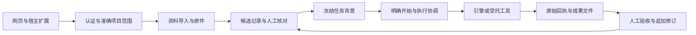

# 架构与数据流

Synplex 将“资料是什么”“人确认了什么”“要执行什么”“工具实际返回什么”分开保存，再通过稳定身份与来源关联起来。

## 主要边界

- `public/`：统一网页界面、草稿、版本、语义操作标识与成果预览。
- `services/workspace/`：SQLite 仓储、权限、HTTP、执行协调、文件与作者修订。
- `packages/contracts/`：固定协议、JSON Schema 与校验。
- `packages/ingestion/`：格式解析、会话归一化与可定位引用。
- `packages/context/`：按目标准备背景，保留必要决定和失败。
- `packages/experience/`：提出附适用条件的经验，等待人工确认。
- `adapters/`、`plugins/`：六工具宿主桥和明确配置的执行适配。
- `integrations/agenthub/`：自有引擎接入、文件、问题、审批、用量及恢复控制。
- `vendor/agenthub/backend/`：可复现的引擎源码、数据库迁移和锁定依赖。
- `scripts/runtime/`：独立启动、发行、备份、恢复与程序升级。

## 数据与一致性

原始文件按内容指纹保存。来源事件与原文件分开，重复导入不伪装新事实。SQLite 事务连接操作、请求身份、记录与状态版本；人工修改追加新版本，原确认与失败历史不被覆写。

任务具有冻结说明、操作、执行尝试、原远端身份、回执与成果关系。提交结果未知时查询原身份；原执行回执已保存而结果写回失败时，仅补写结果，不重做执行。

搜索索引与资料概览是可重建投影，不替代原件、完整记录和人工判断。费用估计、回执用量、业务验收分别记录。

## 权限与运行

本机入口只接受 loopback 网络、准确 Host 与允许的 Origin。网页配对使用短时一次性码，正式凭据只在受保护文件和认证请求头中使用。扩展不能替人批准候选或操作。

单份工作台由 SQLite 运行期租约保护；自有引擎使用私有数据库、队列和生命周期锁。恢复默认停用执行，满足已验证的首次闲置接管条件后才能转移运行权。协议与恢复边界见[维护](OPERATIONS.md)和[当前使用范围](LIMITATIONS.md)。

## 对话与执行共享模型连接

SQLite 管理项目、对话消息、请求事件、加密模型连接、冻结背景、费用单价快照和执行意图。独立 PostgreSQL 管理执行图、工具步骤、文件与引擎回执；队列只承接明确提交的执行。

连续对话从相关项目记录与最近20轮完整对话准备请求，更早记录保留并明确说明容量限制。显式“带入执行”冻结整段选定对话；超出上限拒绝，不静默截短。

自有引擎只获得任务专属模型授权，工作台校验连接版本、型号、思考参数、任务状态、请求次数和回复容量。请求与当时单价一并留存，重复请求返回原字节；未知结果和失败历史保全。个人连接、内置连接和服务商实付独立核对。

## 笔记导入与变化经过

浏览器目录选择只枚举用户授权的文件；`public/obsidian-notes.js`继承Weave的只读、精确原件与显式选项原则，执行普通Markdown解析，不引入任意文件系统路径或后台扫描。上传继续使用鉴权的`import_source`和持久提交身份；笔记库名称与相对位置保存在来源事件的session身份中，原件按内容指纹保存。相同内容的不同出处仍分别保留来源身份。服务端对笔记身份、体积和锁定进行校验，批次中断只核对原回执，不重放执行任务。

`ui_obsidian_notes`为当前项目提供有上限的来源导航投影，不返回原文或本机绝对路径。预览按同库相对位置解析双链和Markdown链接，别名/锚点保持原样；歧义、未导入、外部协议不自动跳转。最近1000次导入之外的导航明确标为不完整；原件和历史仍保留。

`packages/context/record-history.mjs`将已有人工修改关系、修改前后内容与明确原因带入后续任务，标为历史参考。它不从时间顺序推断因果、不把旧结论重新确认、不为准备背景调用模型。按预算整条取舍并在结束时重新校验权限与状态快照。

## 账号与租户

邮箱验证码、账号、持久会话与限流保存在同一SQLite事务域，纳入备份指纹。密码使用带盐scrypt，验证码以独立私有密钥计算校验值，网页登录令牌仅存摘要。注册创建独立owner与actor；项目目录复用准确范围的LocalProjects，原主人需通过私人会话明确选择绑定原项目。内置模型限定owner，个人模型再限定actor。

自有引擎由原私有操作身份申请租户专属组织、用户、Agent与工作流，复用旧AgentHub实体与权限；租户不能自行申请其他身份。提交、问题、审批、用量及工作进程回执都核对组织、用户和工作流。恢复在工作台分区、私有连接指纹和引擎登记表三处核对同一身份，不通过猜测名称重绑任务。

账号登录名与找回密码采用附加表，不重建原账号/owner/actor/项目身份。验证码逻辑按用途封装，保留既有注册验证码校验协议；重置用途使用独立HMAC域和表。密码更新、验证码消费和会话撤销在同一SQLite事务，登录签发用已验证的密码散列作内部内存见证，拒绝重置后的旧凭据签发。数据能力声明account-recovery/1防止不兼容降级；联合恢复覆盖新增表。
